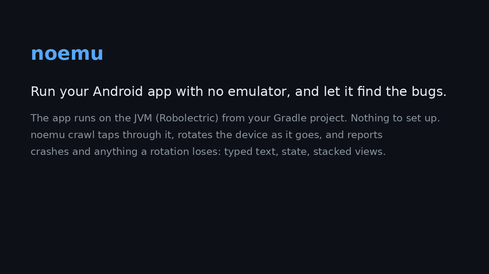

# noemu

> **Status: shelved (2026-10-25).** Robolectric's own [Simulator](https://robolectric.org/simulator/) already runs
> an app interactively on the JVM, and the crawl's check is known from research. What noemu adds (headless text
> control for agents, a lifecycle crawl inside your build) did not prove enough on its own. Why, what it found, and
> what we learnt: [CONCLUSION.md](CONCLUSION.md). It still works; the known gaps are listed there and under Limits.
>
> **Since 2026-10-26: a fleet for parallel agents.** A developer who caps his coding agents at two emulators asked for
> app instances an agent can spawn, put to sleep and destroy fast. [Below](#many-instances-for-parallel-agents-fleet).

**Run your Android app and drive it, with no emulator.** For coding agents in sandboxes that can't run one, and for
anyone who wants to see a screen in seconds instead of booting a device. `noemu crawl` then taps through the app on its
own and reports crashes and what a rotation loses.



```text
$ noemu start
noemu: app running (31s)

activity MainActivity
[2] button Filters  @108,252  (tap)
[10] button Cupcake A tag line  @327,879  (tap)
[16] button Chips  @252,1721  (tap)
[27] button HOME  @246,2589  (tap)
[29] button MY CART  @861,2589  (tap)
screenshot .gradle/noemu/screen.png

$ noemu tap "MY CART"
tapped "MY CART"
activity MainActivity
[1] text Order (3 items)  @303,252
[3] button Gingerbread A tag line $4.99 Qty 2  @616,535  (tap)
[9] text Subtotal  @168,1729
[10] text $54.44  @1085,1729
...
```

That is Google's Jetsnack sample, unmodified, running in a cloud container with no KVM.

## How

Your app runs on the JVM under [Robolectric](https://robolectric.org/), inside a test that noemu's Gradle init script
adds to the app module **for that build only**: nothing in your project changes, nothing to commit. The app starts the
way Android starts it (content providers, then `Application.onCreate`, then the launcher activity), with your real
dependency graph (Hilt, Room, WorkManager, DataStore), and stays running while you send it commands.

`screen` lists what's on screen, numbered, from the Compose semantics tree and the View hierarchy (the same things
accessibility services and UI tests read), in the window that takes the touches: an open dialog or menu, else the
activity. Each command returns the new screen and saves a screenshot.

## Crawl for crashes and lost state

`noemu crawl 100` taps through the app on its own, typing into fields and submitting them. On every new screen, and
after every action that changes one, it rotates the device there and back: the activity is rebuilt from its saved
state, with the other orientation's layouts on the way. Once per screen it also kills the app in the background and
reopens it, as Android does to apps you leave: ViewModels gone, only saved state left. It reports:

- **problems**: crashes (where thrown, and the taps that led there), text it typed that a rotation lost, views
  stacked again on each rotation, and screens leaked in memory, with the chain of references that holds them (found
  by LeakCanary's analyzer);
- **worth a look**: anything else a rotation changed, such as a search bar closing, which may be fine.

```text
$ noemu crawl 100        # Fossify Calendar, the release before its fix for issue #644
crawled 30 actions over 30 distinct screens; 0 distinct crash(es), 1 rotation problem(s)

MainActivity: 52 elements before rotating there and back, 144 after; shown more than once now: "button Go to
previous month", "button October", "button Go to next month"
  after: rotate > rotate
```

Users reported that one as [#644](https://github.com/FossifyOrg/Calendar/issues/644), "App crashes after rotating
several times": each rotation stacked another copy of the calendar until the app died (the crawl slowed down too, and
stopped at its 10-minute budget). The release with the fix shows no stacking. Failures of the JVM stand-in itself (a
GPU-only shader, say) are listed apart, as not app bugs.

[What the crawl found on real apps](bench/CRAWL_EVIDENCE.md): in Google's own Compose samples, a crash in Jetchat
(send the same message twice) and a search query that Jetsnack, Reply and Jetcaster each lose on rotation; five
historical bugs from Fossify Calendar, File Manager, Calculator and Notes, none reported on the fixed code; no crashes on
today's Fossify apps.

## Install

```bash
pipx install git+https://github.com/trOnk12/noemu
```

It needs Python 3.10+, JDK 17+ (plus a JDK 21 installed when the build runs on 17) and what your project already builds with (Android SDK, Gradle wrapper). Robolectric
comes in through Gradle, for the run only.

## Use

```bash
cd your-android-project
noemu start [--module :app] [--task testDebugUnitTest] [--activity com.example.EditorActivity [--data file:///tmp/a.txt]]
noemu screen
noemu tap 16              # by number
noemu tap "Sign in"       # or by label
noemu type 2 "hello@example.com"
noemu scroll down | noemu back | noemu rotate | noemu kill | noemu leaks | noemu wait 2000
noemu open .SettingsActivity | noemu open myapp://chat/42    # an activity, or a deep link (ACTION_VIEW)
noemu shot out.png | noemu logs
noemu crawl 100 [MINUTES]   # every decision it takes goes to .gradle/noemu/crawl.log
noemu stop
```

## Many instances for parallel agents (fleet)

First, `noemu doctor --module :app [--task test<Flavor>DebugUnitTest]` reads the project (it runs nothing) and says what
will stand in the way: JDK 21, the Android SDK, the app module, flavors, JUnit 5, Android-only native libraries (with
the JVM build to add, where one exists), disk space.

Build once; then each instance is one JVM started from the recorded command, with no Gradle and no emulator.
Instances wait in a pool, asleep (no CPU), so an agent's `spawn` only wakes one.

```bash
noemu build --module :app          # after every code change (an incremental build here: about 20 s)
noemu pool 4                       # start 4 and put them to sleep (each pays the full start once)
noemu spawn                        # -> "ID PORT": a pooled instance woken, or a fresh one if the pool is empty
NOEMU_ID=ID noemu screen           # every command above works on an instance (or: noemu --id ID tap "Sign in")
noemu sleep ID | noemu wake ID     # freeze / resume its JVM; the app's state stays
noemu destroy ID                   # or: noemu destroy all
noemu list
```

`spawn` refills the pool in the background. `build` drops pooled instances of the previous build, so an agent never
gets old code; instances already handed out keep running until destroyed. Each instance has its own app data
(Robolectric's temporary directory), removed by `destroy`. Settings, per instance at start: `NOEMU_SETTLE_MS` (the longest an
action waits for the screen to settle, default 4000; numbers that keep changing, like a clock or a timer, don't count
as unsettled),
`NOEMU_SHOTS=0` (no screenshot after every action), `NOEMU_IDLE_MIN` (an instance no agent has used for that many
minutes ends itself; time asleep in the pool doesn't count), `NOEMU_XMX` (heap, default 1g), `NOEMU_JVM_ARGS` (default
`-XX:+UseSerialGC -XX:TieredStopAtLevel=1`, which made instances about 17% smaller and a second faster to start).

Measured on a Compose Multiplatform app (`androidTarget`) in a 4-core, 16 GB container with no KVM, while other
jobs loaded it ([details](bench/FLEET.md)):

| | |
| --- | --- |
| Spawn from the pool (wake + readable screen) | about 0.4 s |
| Sleep / wake (state kept) | about 50 ms / 0.4 s |
| Destroy | under 0.1 s |
| Full start (refilling the pool, or `spawn` with an empty pool) | about 10 s (Android ready 6 s, app 9 s, settled 10 s); slower under load |
| Memory per instance | about 390 MB; 12 started at once in 56 s and used 4.6 GB together |
| Tap answered (default settings, `NOEMU_SHOTS=0`) | 0.6-0.8 s, also on a screen with a running clock |

**Kotlin Multiplatform**: point `--module` at the module that applies `com.android.application` (often `:composeApp`
or `:androidApp`). Modules testing on the JUnit Platform (`kotlin.test`) are supported. noemu runs the Android
target only: iOS needs a simulator.

**Apps that load native libraries.** Android `.so` files can't load on the JVM. When a library also ships a JVM
artifact with the same classes and host libraries, add it with `NOEMU_DEPS` (comma-separated coordinates).

**Wire (wire-android with Kalium)** — prepared from Wire's source, not yet run (this environment couldn't build it):

```bash
git clone --recurse-submodules https://github.com/wireapp/wire-android && cd wire-android   # JDK 21
NOEMU_DEPS=com.wire:core-crypto-jvm:10.5.4 noemu build --module :app --task testDevDebugUnitTest
```

- `core-crypto-jvm` has the same 466 classes as `core-crypto-android` (bar 2 Android-only helpers) plus
  `linux-x86-64` and `darwin-aarch64` libraries, so Kalium's MLS and Proteus can run. Match its version to
  `core-crypto` in `kalium/gradle/libs.versions.toml`.
- A debug build on Android 11+ (noemu runs SDK 36) doesn't encrypt Kalium's databases (`shouldEncryptData` in
  `KaliumConfigsModule`), so SQLCipher's Android library is never loaded.
- The `dev` flavor talks to Wire's staging backend; log in with a test account.
- Calls (AVS) won't work: AVS ships Android libraries only.

**As an MCP server.** `noemu mcp` serves the same commands as tools (`spawn`, `screen`, `tap`, `type`, `scroll`,
`back`, `rotate`, `wait`, `open` (an activity or a deep link), `shot` (an image), `logs`, `sleep`, `wake`, `destroy`, `list`, `pool`, `build`) over stdio,
so an agent calls them directly instead of composing shell commands. Run it from the project root. For Claude Code:

```bash
cd your-android-project
claude mcp add noemu -- noemu mcp     # or in .mcp.json: {"mcpServers": {"noemu": {"command": "noemu", "args": ["mcp"]}}}
```

Checked on the KMP demo through a JSON-RPC client: `spawn` returned an instance and its first screen, `tap` answered in
0.64 s, `shot` returned a PNG, a wrong id came back as a tool error, `destroy` in 0.05 s.

For your agents' instructions (AGENTS.md / CLAUDE.md):

```markdown
## Running the app without an emulator (noemu)
- After changing code, `noemu build --module :composeApp`.
- `noemu spawn` prints `ID PORT`; then `NOEMU_ID=ID noemu screen`, `... tap "Label"`, `... type 2 "text"`,
  `... back`, `... rotate`. Read the numbered screen text; `... shot out.png` only when you need pixels.
- When done, `noemu destroy ID`.
- Use an emulator only for what noemu can't run: Google Play services, camera, WebView, real GPU.
```

## Tested on

| App | Stack | Start |
| --- | --- | --- |
| Jetsnack (android/compose-samples) | Compose | 31 s |
| JetNews (android/compose-samples) | Compose | 75 s first build |
| JetLagged (android/compose-samples) | Compose, AGSL shaders (`RuntimeShader`) | 13 s |
| Now in Android | Compose, Hilt, Room, WorkManager, Firebase, dialogs, Gradle isolated projects | 93 s first build |
| Fossify Notes | Views (XML), splash + several activities, Room, dialogs | 36 s |

## Does it make agents better?

On six Jetsnack tasks (features and bug reports), an agent with noemu and one without both got 6/6
([study](bench/AGENT_STUDY.md)). noemu didn't make the code better. It let the agent check its work in the running app
and say so ("after I tapped 'Clear cart', the header read 'Order (0 items)'"), where the other could only write "I haven't
seen it on screen".

## Check it yourself

`python bench/reproduce.py WORKDIR` clones the apps at pinned commits and replays, with fixed noemu commands (not a
crawl), 6 of the bugs above, 1 leak planted for the test and 3 fixed versions that must stay clean: 10 of 10 held ([results, and a second reviewer's reading of the upstream code](bench/REPRODUCED.md)).

## Next to the usual tools

[Measured in a cloud container](bench/COMPARISON.md): the Android Emulator refuses to start there (no KVM), so every
device-based tool is out; Android Lint reports 123 and 43 warnings on Jetchat and Jetsnack and none about the bugs
noemu found; an agent reading noemu's screen text spends 3.5-6x fewer tokens per look than with a screenshot.

## What else exists

- **Robolectric's [Simulator](https://robolectric.org/simulator/)** (since Robolectric 4.15, 2025, "highly
  experimental") runs an app's main activity interactively on the JVM, in a desktop window, from
  `./gradlew simulate<variant>`. noemu differs in what is around that: no display (numbered screen text for agents),
  any activity, and the rotate, kill, leak and crawl commands.
- **Agent tools that drive Android** ([mobile-mcp](https://github.com/mobile-next/mobile-mcp),
  [android-mcp](https://github.com/remymazmanian/android-mcp), Google's Android CLI for agents, 2026) need a device or
  an emulator. [compose-ai-tools](https://github.com/yschimke/compose-ai-tools) drives Compose `@Preview`s through
  Robolectric for agents.
- **Explorers that check rotation and restarts**: ALARic (ISSTA'18), Quantum (ICST'14), Thor (ISSTA'15) and
  [DLD](https://arxiv.org/abs/2010.05584) (ISSTA'20) use the same oracle as noemu's crawl (the screen before and after),
  on devices or emulators; [RotDroid](https://arxiv.org/abs/2608.25425) uses a vision model;
  [iFixDataloss](https://arxiv.org/abs/2209.08719) finds and patches data loss. DDLDroid (ISSTA'23), KREfinder and
  LiveDroid find such bugs statically, with no device at all.
- **Robolectric and [Roborazzi](https://github.com/takahirom/roborazzi)** run app code on the JVM in tests you write;
  `StateRestorationTester` checks `rememberSaveable` per composable.

## Limits

- It is Robolectric, not a device: no GPU (shaders are drawn on the CPU), no camera, no real sensors; rendering is
  close, not pixel-identical.
- Needs a JDK 17 or newer, plus a JDK 21 installed when the build runs on 17 (Gradle finds it).
- WorkManager work that waits on constraints doesn't run on its own yet.
- It grants the app's permissions and "all files access" up front, as a user would at the first prompt; a crawl with
  `--data` can save to that file.
- `kill` rebuilds the top activity from its saved state; the Application, singletons, statics and the activities
  below survive, so it misses the most common real process-death bugs.
- A crash with no frame from the app's package on the stack (a Compose layout error, a `Parcel` failure in `kill`) can
  be filed under JVM limits instead of crashes, and taps can reach disabled views (found in review, not fixed).
- One screen size per session (411x891 dp).
- Fleet: instances run the code of the last `noemu build`; sleep and wake use SIGSTOP/SIGCONT (Linux and macOS, not
  Windows); `list` shows memory on Linux only; an asleep instance keeps its memory. Each instance unpacks Robolectric's
  native runtime (about 200 MB) into the temporary directory; `destroy` removes it, but an instance that dies another
  way (crash, `kill -9`) leaves it behind.
